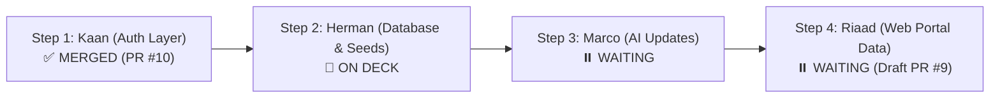

# 🚀 Instructions & Context for Herman (Lekabe) — Step 2: Database Layer & Seed Data

**Target:** Herman / Lekabe (@HMaba / @Lekabe)  
**Assigned Responsibility:** Step 2 — Hosted Cloud PostgreSQL & Database Seeding  
**Status:** 🟢 **UNBLOCKED & ON DECK** (Step 1: Kaan's Auth Layer has been merged via PR #10)  
**Submission Deadline:** Friday, 2 October 2026  

---

## 1. Executive Context & Current Baseline

We have transitioned to a **strict sequential merge workflow** to avoid merge conflicts:



### What Kaan Just Merged (Current State of `develop`):
* `AuthController.cs` is live (`/api/auth/login`, `/refresh`, `/revoke`, `/forgot-password`, `/me`).
* `[EnableRateLimiting("auth-strict")]` is active.
* `IEmailService` is wired for password resets.
* All secrets have been completely removed from Git history. `Jwt:Key` is loaded strictly via .NET User Secrets or environment variables.
* Solution builds with **0 errors**, and all **27 xUnit tests pass**.

> [!IMPORTANT]
> **Riaad's Frontend and Marco's AI layer are paused waiting for you.** Riaad's web portal data screens currently 500 until a real database with seeded records exists.

---

## 2. Herman's Exact Deliverables

You have 3 primary tasks for Step 2:

1. **Provision Hosted PostgreSQL**:
   - Set up a free-tier PostgreSQL instance on **Supabase**, **Neon.tech**, or **Railway**.
   - Ensure external connections with SSL (`sslmode=Require`) are enabled.

2. **Configure EF Core Relationships in `ApplicationDbContext.cs`**:
   - As marked in `Strategies.Api/Data/ApplicationDbContext.cs` (`// Lekabe will add relationships and foreign keys here in Phase 2`), define fluent API relationships and table constraints.

3. **Initial Migration & Seeding**:
   - Generate and apply initial EF Core migration to the cloud database.
   - Seed baseline records so the team is not testing against empty tables:
     - **Users**: Admin, Consultant, and Client with BCrypt password hashes.
     - **Leads**: Intake leads across `Qualified`, `Unqualified`, and `NeedsReview` statuses.
     - **Cases**: Sample migration cases advancing through stages.
     - **Messages/Notifications**: Sample case messages for the notification bell.

---

## 3. Step-by-Step Execution Guide

### Step 3.1: Pull Latest `develop` and Create Feature Branch
Open PowerShell in the repository root:

```powershell
# 1. Fetch latest changes from remote
git fetch origin develop

# 2. Switch to develop and pull Kaan's merged PR #10
git checkout develop
git pull origin develop

# 3. Create your dedicated feature branch
git checkout -b feature/lekabe-database-seed
```

---

### Step 3.2: Configure Cloud Connection String Locally
Never put database passwords into `appsettings.json`. Instead, store your connection string in your local .NET User Secrets store:

```powershell
cd Strategies.Api

# Set your hosted PostgreSQL connection string:
dotnet user-secrets set "ConnectionStrings:DefaultConnection" "Host=your-db.supabase.co;Port=5432;Database=postgres;Username=postgres;Password=YourSecurePassword!;SslMode=Require;Trust Server Certificate=true"

# Verify that it is registered:
dotnet user-secrets list
```

---

### Step 3.3: Finalize `ApplicationDbContext.cs` Relationships
Open `Strategies.Api/Data/ApplicationDbContext.cs` and configure foreign keys and indexes inside `OnModelCreating`:

* `Case` ➔ belongs to `User` (Client) and assigned to `User` (Consultant).
* `Document` ➔ belongs to `Case` and uploaded by `User`.
* `Lead` ➔ triage status enum string conversion and unique index on `Email`.
* `Message` ➔ belongs to `Case` and `User` (Sender).

---

### Step 3.4: Create and Apply EF Core Migration

```powershell
# In Strategies.Api directory:
dotnet ef migrations add InitialDatabaseSchema
dotnet ef database update
```

---

### Step 3.5: Seed Baseline Data
Ensure the database has the following test accounts and data matching the existing tests and frontend contracts:

#### Required User Accounts (BCrypt Hashed)
| Role | Email | Password | Display Name |
| :--- | :--- | :--- | :--- |
| **Admin** | `admin@nexus.com` | `AdminPassword123!` | System Administrator |
| **Consultant** | `consultant@nexus.com` | `ConsultantPassword123!` | Senior Consultant |
| **Client** | `client@nexus.com` | `ClientPassword123!` | Test Client |

#### Sample Leads
* At least 1 `Qualified` lead.
* At least 1 `Unqualified` lead.
* At least 1 `NeedsReview` lead (to test the AI intake fallback).

#### Sample Cases & Documents
* 1 Active Case linked to `client@nexus.com` in `DocumentGathering` or `UnderReview`.
* 1 Archived / Completed Case.
* 2-3 sample documents attached to the case.
* 1-2 unread messages sent to `client@nexus.com` and `consultant@nexus.com` to verify the `/api/notifications` bell badge.

---

### Step 3.6: Verify Build & Tests Locally

Before pushing, verify that your changes did not break existing contracts:

```powershell
dotnet build
dotnet test
```

Expected result: **0 build errors, 27/27 tests passing**.

---

### Step 3.7: Commit, Push, and Open PR

```powershell
git add .
git commit -m "feat(db): configure EF Core relationships, initial migration, and seed data"
git push -u origin feature/lekabe-database-seed
```

Open your Pull Request targeting `base: develop`:
```powershell
gh pr create --base develop --head feature/lekabe-database-seed --title "feat(db): hosted database schema, EF migrations, and initial seed" --body "Configured cloud PostgreSQL connection, applied initial EF Core migration, and seeded users, cases, and leads."
```

---

### Step 3.8: Handover to Marco (Step 3)

1. Post your PR link in the team chat.
2. Send the hosted connection string securely to **Marco** via DM so he can add it to GitHub Actions Secrets (`DATABASE_URL` / `ConnectionStrings:DefaultConnection`) and begin Step 3 (AI Updates).
