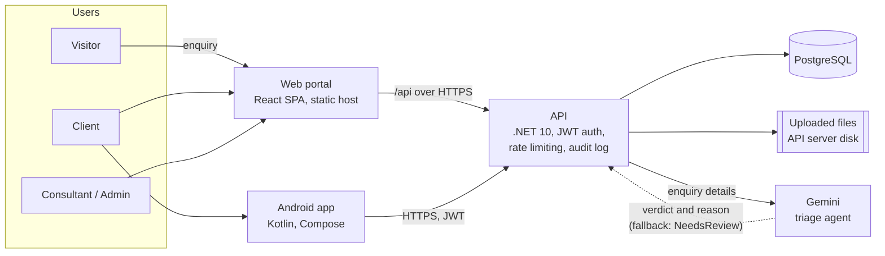

# Strategies Migration Platform

Case management for **Strategies Migration Services**, a South African immigration consultancy. Built by Team Nexus Solutions for INSY7315 (Work Integrated Learning).

<!-- TODO(video): replace VIDEO_ID twice with the YouTube id of the demo, then delete this comment.
[](https://www.youtube.com/watch?v=VIDEO_ID)
-->
**Demo video:** TODO(video): link to follow.

| Live system | Address |
|---|---|
| Web portal | TODO(url): hosted web portal address |
| API | TODO(url): hosted API address |

## The problem and the solution

About 80% of the consultancy's web enquiries were junk that staff had to sort by hand, and clients had no way to see how far their application had gone.

The platform has three parts:

1. **Public enquiry form.** Anyone can send an enquiry after giving POPIA consent. The API validates it and asks a Gemini triage agent whether the lead is qualified. If the AI is unavailable or unsure, the lead goes to a consultant as NeedsReview, so no enquiry is lost.
2. **Staff portal.** Consultants review the leads the AI could not decide, manage their cases and approve or reject documents. Administrators manage users, assign cases to consultants for an even workload and read the audit trail.
3. **Client tracking.** Clients follow their case through five stages on the web or the Android app, and upload a new copy of any document a consultant rejects.

The five stages: **Initial intake → Document gathering → Under review → Submitted to authority → Final decision**.

## Components

| Component | Folder | Technology | Owner | Status |
|---|---|---|---|---|
| API | [`Strategies.Api`](Strategies.Api) | .NET 10, EF Core, JWT, bcrypt, Gemini | Marco (API, AI), Kaan (security) | Working; open issues in [ISSUES.md](docs/ISSUES.md) |
| Database | [`database`](database/seed/README.md), EF migrations | PostgreSQL | Lekabe | 3 migrations, demo seed data |
| Web portal | [`strategies-web`](strategies-web/README.md) | React 19, Vite, Tailwind, React Router | Riaad | All three roles working against the real API |
| Android app | [`strategies-mobile`](strategies-mobile/README.md) | Kotlin, Jetpack Compose | Kundai | Client role: sign-in, case progress, documents, notifications |
| CI and deployment | [`.github/workflows`](.github/workflows/ci.yml) | GitHub Actions | Mbulungeni | CI on every push and pull request |

## Architecture



- The web portal calls the API through relative `/api` paths (a dev proxy locally, a host rewrite in production), so the browser never needs CORS.
- Only the API talks to Gemini; the key never reaches a browser or phone.
- Staff changes are recorded in an audit trail: case creation, stage changes and assignments, document reviews and archiving, lead reviews, and user suspensions, reinstatements and deletions.
- Uploaded files are validated on the server (PDF, JPG or PNG, 5 MB at most) and stored on the API server's disk. Cloud storage was planned: see [ISS-09](docs/ISSUES.md#iss-09).

## Quick start (local)

### Prerequisites

- .NET 10 SDK and the EF Core tool: `dotnet tool install --global dotnet-ef`
- PostgreSQL (tested with version 17)
- Node.js 22 and npm
- Android Studio (for the mobile app only)

### 1. Database

Create an empty database (for example `strategies`), apply the migrations, then load the demo data. The exact commands are in [database/seed/README.md](database/seed/README.md).

```bash
cd Strategies.Api
dotnet ef database update
```

### 2. API

Secrets are kept out of the repository with .NET user secrets ([ISS-02](docs/ISSUES.md#iss-02) lists values that still need to move out of `appsettings.json`).

```bash
cd Strategies.Api
dotnet user-secrets set "ConnectionStrings:DefaultConnection" "Host=localhost;Port=5432;Database=strategies;Username=postgres;Password=<your password>"
dotnet user-secrets set "Jwt:Key" "<a random string of at least 32 characters>"
dotnet run --launch-profile http
```

The API listens on http://localhost:5151 and, in Development, serves Swagger at http://localhost:5151/swagger

| Setting | Purpose | Required |
|---|---|---|
| `ConnectionStrings:DefaultConnection` | PostgreSQL connection | Yes |
| `Jwt:Key` | Signs access tokens | Yes |
| `Jwt:Issuer`, `Jwt:Audience` | Token issuer and audience | Defaults in `appsettings.json` |
| `Gemini:ApiKey` | AI triage | No: without it every enquiry is saved as NeedsReview |
| `Gemini:Url` | Gemini model endpoint | Default in `appsettings.json` |

### 3. Web portal

```bash
cd strategies-web
npm ci
npm run dev
```

Open http://localhost:5173 (requests to `/api` are forwarded to the API on port 5151).

### 4. Android app

Open `strategies-mobile` in Android Studio and run the `app` configuration on an emulator. Debug builds call the API at `http://10.0.2.2:5151/`. See [strategies-mobile/README.md](strategies-mobile/README.md).

### 5. Sign in

Demo accounts for each role (`admin@nexus.com`, `consultant@nexus.com`, `client@nexus.com`) and their passwords are listed in [database/seed/README.md](database/seed/README.md). They are demo data only.

## Tests and quality

| Part | Command | Result on `develop` |
|---|---|---|
| API | `dotnet test` (repository root) | 27 of 27 passed |
| Web | `cd strategies-web`, then `npm test`, `npm run lint`, `npm run build` | 185 of 185 passed, lint and build clean |
| Mobile | `ModelsTest` in Android Studio | See the [mobile test log](strategies-mobile/TESTING.md) |

CI runs the API build and tests and the web lint, tests and build on every push and pull request. The full test plan, requirement traceability and manual results are in [docs/TESTING.md](docs/TESTING.md).

Team rules: you must verify your work. All tests must pass before code is considered for integration; broken builds and untested logic are rejected. Branch from `develop` (`feature/<name>-<task>`), open a pull request, and merge only when CI is green. Never push to `main` or `develop` directly. Commit messages follow Conventional Commits, for example `feat(web): ...`.

## AI: planned and delivered

| Planned | Delivered |
|---|---|
| Conversational intake agent | A structured two-step enquiry form with POPIA consent, validated before any AI call |
| Triage agent | Delivered: Gemini returns a verdict and a reason, which consultants see; any failure falls back to NeedsReview |
| Document checklist agent | Checklist templates exist in the database; no API yet |
| Summarisation agent | Not delivered; the case lifecycle was prioritised |

Details and the other features not delivered are in [ISSUES.md section 2](docs/ISSUES.md#2-planned-but-not-delivered).

## Documentation

| Document | What it covers |
|---|---|
| [docs/USER_GUIDE.md](docs/USER_GUIDE.md) | Step-by-step guide for administrators, consultants and clients |
| [docs/TESTING.md](docs/TESTING.md) | Test plan, requirement traceability and results |
| [docs/ISSUES.md](docs/ISSUES.md) | Open issues, features not delivered, issues fixed |
| Swagger | Live API reference at `/swagger` when the API runs in Development |
| [strategies-web/README.md](strategies-web/README.md) | Web portal design, sessions, accessibility, deployment |
| [strategies-mobile/README.md](strategies-mobile/README.md) | Android app setup and session handling |
| [database/seed/README.md](database/seed/README.md) | Migrations, demo data and demo accounts |

## Team Nexus Solutions

| Member | Role |
|---|---|
| Marco | Team lead, API and AI |
| Kaan | Security: authentication, rate limiting, file storage |
| Lekabe | Database and migrations |
| Kundai | Android app |
| Mbulungeni | Repository, CI, QA and deployment |
| Riaad | Web portal, integration testing, documentation |
