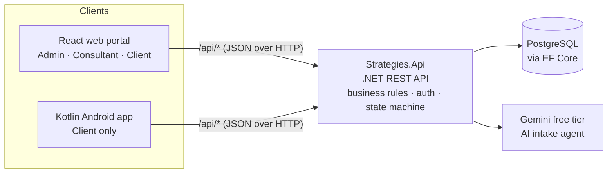

# Strategies Migration Services: Web Portal

The web front end of the Strategies Migration Services case management platform, built by Team Nexus Solutions for INSY7315 (Work-Integrated Learning).

The client, a South African immigration consultancy, received most enquiries through unstructured website forms, and around 80% of them were not viable. Staff triaged every one by hand. This portal replaces that process: the public submits a structured enquiry, an AI intake agent on the server screens it, consultants review only what the agent could not qualify, and clients follow their case through a five-stage lifecycle.

This folder contains the React web portal only. The .NET API (`Strategies.Api`) and the Kotlin Android app (`strategies-mobile`) live alongside it in the same repository.

## What each role sees

Each role signs in to its own workspace with its own landing page, navigation and permissions.

| Role | Landing page | What they can do |
|---|---|---|
| **Public visitor** | Sign in / Start an enquiry | Submit a two-step enquiry with POPIA consent and receive a reference; request a password reset |
| **Consultant** | Today's caseload | See the intake agent's results (screened, awaiting review, qualified, filtered out), work through the lead triage queue with search, filters and sorting, open any lead to see the full enquiry and the agent's verdict, email the lead, and follow their cases |
| **Client** | My case | Follow their application through the five lifecycle stages, see what happens next, their case reference and when it was opened |
| **Administrator** | System overview | See account, case and enquiry totals, manage users (view and suspend with confirmation), browse and export cases to CSV, and read the audit log |

Every workspace also has breadcrumbs, a notification bell with unread count and mark-as-read, toasts for completed actions, and loading, empty and error states with a retry option.

The case lifecycle shown to clients and staff follows the backend state machine:
`Initial intake → Document gathering → Under review → Submitted to authority → Final decision`.

## Technology choices

| Concern | Choice | Why |
|---|---|---|
| UI library | React 19 | Component model suits three role-based workspaces that share building blocks (tables, tiles, panels). It is the team's most familiar front-end stack. |
| Build tool | Vite 8 | Fast dev server with a built-in proxy, so the portal talks to the local API without CORS configuration. |
| Routing | React Router 7 | Nested routes give each role its own shell and URL space (`/admin`, `/consultant`, `/client`). |
| Styling | Tailwind CSS 4 | Design tokens (brand red, neutrals, type) are defined once in `src/index.css` and used consistently. No component library, so the interface is built for this client rather than themed from a kit. |
| Icons and type | lucide-react, IBM Plex Sans | One consistent icon set. A typeface with clear figures for tables and dates. |
| Testing | Vitest | Shares Vite's configuration, so tests run the same code the app runs. |
| Linting | ESLint (flat config) with React Hooks rules | Catches hook misuse and unused code before review. |

Language: JavaScript (ES modules). Package manager: npm, with `package-lock.json` committed.

## Architecture



The portal never talks to the database or the AI service directly. Every request goes through the API, which enforces authentication, role permissions and validation. AI keys exist only on the server.

Inside the portal, code is split into layers:

| Layer | Folder | Responsibility |
|---|---|---|
| Presentation | `src/pages`, `src/components` | Screens and reusable UI (tables, tiles, dialogs, toasts). No direct `fetch` calls. |
| Data access | `src/lib/api.js`, `src/lib/useApi.js` | One HTTP client that turns failed responses into typed `ApiError`s with a status code, and a hook that returns `{ data, loading, error, reload }` and cancels stale requests. |
| Logic | `src/lib` | Pure, tested functions: validation, table search/filter/sort/pagination, triage counting, formatting. |
| Configuration | `src/config` | Enum labels and colours matching the backend enums, the lifecycle stages, and each role's navigation. |

## Getting started

### Prerequisites

- Node.js 22 LTS (Vite 8 needs a recent Node release)
- The .NET SDK, to run `Strategies.Api` locally

### 1. Install

```bash
cd strategies-web
npm ci
```

`npm ci` installs the exact versions in `package-lock.json`.

### 2. Configure (optional)

```bash
cp .env.example .env.local
```

Only needed if your API does not run on `http://localhost:5151`. See [Environment variables](#environment-variables).

### 3. Run the API and the portal

In one terminal:

```bash
cd Strategies.Api
dotnet run --launch-profile http
```

In a second terminal:

```bash
cd strategies-web
npm run dev
```

Open http://localhost:5173. Requests to `/api/*` are forwarded to the API.

## Scripts

| Command | What it does |
|---|---|
| `npm run dev` | Starts the dev server on port 5173 with the `/api` proxy |
| `npm run build` | Builds the production bundle into `dist/` |
| `npm run preview` | Serves the production build locally |
| `npm test` | Runs the Vitest suite once |
| `npm run lint` | Runs ESLint across the project |

## Environment variables

| Variable | Used by | Default | Purpose |
|---|---|---|---|
| `API_PROXY_TARGET` | `vite.config.js` (dev server only) | `http://localhost:5151` | Where `/api` requests are forwarded during development |

The portal holds no secrets. Variables without the `VITE_` prefix are never included in the browser bundle.

## How the portal talks to the API

- All calls use relative `/api/...` paths. The dev server forwards them to the API. In production, the host forwards them (see [Deployment](#deployment)).
- Error handling maps status codes to plain-language messages, for example 401 (incorrect details), 403 (inactive account), 429 (too many attempts). The public enquiry form never shows technical errors to visitors.
- List endpoints may return a plain array or a paginated wrapper `{ data, totalRecords, totalPages, currentPage }`. `src/lib/listData.js` accepts both.
- Enums are accepted as text (`"UnderReview"`) or numbers (`2`), so the portal works whether or not the API serialises enums as strings.
- Dashboard figures are counted from the same list endpoints the tables use, so a tile can never disagree with the list beneath it.

Endpoints the portal uses:

| Method | Endpoint | Used by |
|---|---|---|
| POST | `/api/auth/login` | Sign in |
| POST | `/api/auth/forgot-password` | Forgot password |
| POST | `/api/leads` | Public enquiry form |
| GET | `/api/leads` | Consultant overview and lead triage; admin overview |
| GET | `/api/cases?page=&pageSize=&search=` | Cases pages; overviews |
| GET | `/api/cases/export?format=csv` | Export CSV |
| GET | `/api/cases/client/{clientId}` | Client overview |
| GET | `/api/admin/users?page=&pageSize=` | Users page; admin overview |
| PATCH | `/api/admin/users/{id}/suspend` | Suspend user |
| GET | `/api/admin/audit-logs` | Audit log; admin overview |

The notification bell also uses the API's notification endpoints (see `src/lib/notifications.js`).

## Project structure

src/
main.jsx App entry: router and toast provider
App.jsx Route table, one shell per role
index.css Design tokens and base styles
routes/ Role guard and the list of built modules
config/ Enums, lifecycle stages, navigation
lib/ API client, hooks and tested pure functions
components/
layout/ App shell, auth layout, notification bell
ui/ Data table, pagination, tiles, badges, dialogs, toasts
dev/ Development-only role switcher
pages/
admin/ Overview, users, audit log
consultant/ Overview, lead triage
client/ Overview (my case)
cases/ Cases list shared by admin and consultant
Login, ForgotPassword, EnquiryPage, NotFound


## Quality

- **Tests:** 72 Vitest tests in 10 files cover form validation, table search/filter/sort/pagination, enum handling, date and ID formatting, triage counting, API error handling, auth messages, notifications and navigation. Run `npm test`.
- **Linting:** `npm run lint` passes with no warnings.
- **Accessibility:**
  - labelled form fields with linked error messages
  - keyboard-operable option cards and dialogs
  - visible focus rings
  - `aria-sort` on sortable columns
  - `aria-current` on the active page and the current lifecycle stage
  - focus moved to each new step of the enquiry form
- **Responsive:** the sidebar becomes a slide-out menu below 1024px, tables scroll horizontally on small screens, and the lifecycle stepper switches to a vertical list on phones.

## Security and privacy

- **Permissions are enforced by the API.** The portal hides pages a role cannot use, which improves the experience, but every role-restricted action is checked on the server.
- **No secrets in the browser.** AI, database and token-signing keys exist only on the server.
- **No account enumeration.** The forgot-password page always shows the same message, whether or not the account exists.
- **POPIA.** The enquiry form requires explicit consent before any personal information is sent, and every public page carries a privacy note.
- **The development role switcher** (the "Dev" button) renders only when `import.meta.env.DEV` is true and is removed from production builds.

## Deployment

1. Run `npm run build` to produce static files in `dist/`.
2. Host `dist/` on a static host with HTTPS, such as Vercel or Netlify.
3. Add a rewrite that serves `index.html` for unknown paths, so direct links like `/consultant/leads` work.
4. Add a rewrite that forwards `/api/*` to the deployed API, so the portal keeps using relative paths and needs no CORS setup.

## Current status

- The portal runs end to end against the API's mock contracts (`develop`, PR #2). No database is required for a demo.
- Sign-in validates input and handles every error response. Starting a session waits on the auth endpoint (`AuthResponse` with access and refresh tokens). Until then, the development role switcher opens each workspace.
- Planned once auth is merged: bearer tokens on every request, refresh on 401, sign-out with token revocation, and mapping the token's role to its workspace.
- Modules not yet built (documents, messages, profile, reports) are hidden from navigation. Visiting their URL directly shows a neutral placeholder.

## Contributing

- Branch from `develop` as `feature/<name>-<task>`. Never push to `main` or `develop` directly.
- Open a pull request into `develop`. Run `npm test` and `npm run lint` first.
- Commit messages follow Conventional Commits, for example `feat(web): ...`, `fix(web): ...`, `docs(web): ...`.

Web portal: Riaad Hercules, Team Nexus Solutions.
